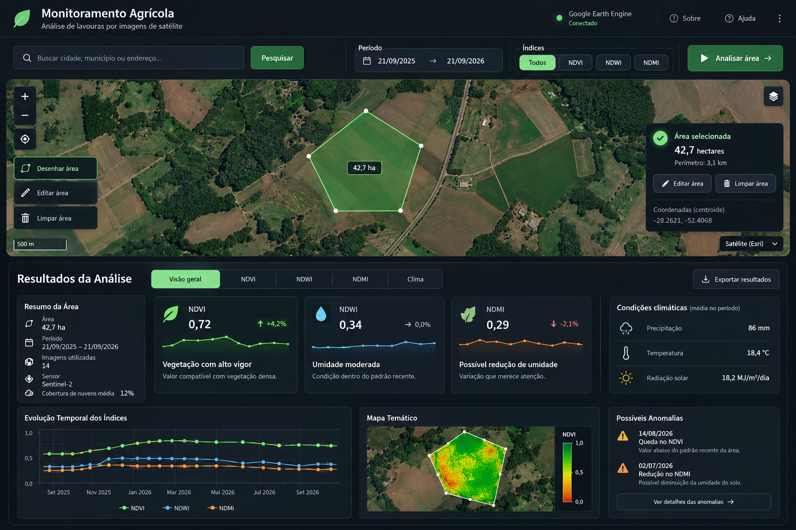

# Spec: UI V2 — Paridade Visual do Dashboard

## Propósito

Complementar a UI V2 Map-First da SPEC-14 com a composição visual de dashboard
aprovada pelo usuário. A implementação deve reproduzir a hierarquia e os painéis
da imagem de referência, mantendo os fluxos científicos e exibindo exclusivamente
dados reais da área e dos serviços integrados.

## Referência visual obrigatória

Arquivo-base versionado: `assets/dashboard-reference.png` (1536 × 1024 px).
O viewport de referência desktop para comparação é, portanto, 1536 × 1024 CSS
pixels. A imagem é a fonte visual normativa para hierarquia, agrupamento e
proporções; não substituir por imagem redesenhada, mock ou captura da aplicação.

### Inventário visual e contrato de dados

| Região | Elementos/campos visíveis | Contrato para implementação |
|---|---|---|
| Cabeçalho | Identidade do produto, estado do Earth Engine, ações Sobre/Ajuda/menu | Identidade e estado devem refletir a aplicação/serviço existentes; ações só aparecem quando têm destino funcional. |
| Barra de controles | Busca, botão Pesquisar, período, escolha Todos/NDVI/NDWI/NDMI, Analisar área | Usar geocodificador, datas, validação e semântica de análise existentes; não inventar valores de filtro. |
| Mapa e seleção | Base satélite, desenho/edição/limpeza, escala, área em ha, perímetro em km, centroide, seletor de camada | Derivar métricas da geometria real; controles devem ser funcionais. A camada e sua disponibilidade devem corresponder ao serviço real. |
| Resumo da análise | Área, período, contagem de imagens, sensor/coleção e cobertura de nuvens | Área, período e contagem vêm da geometria/pipeline; sensor/coleção só quando confirmados. Cobertura de nuvens só se existir métrica e agregação documentadas. |
| Cartões espectrais | NDVI, NDWI e NDMI, valor médio, variação/tendência e descrição | Valores vêm dos resultados reais. Variação exige período de comparação e cálculo definido; descrições não podem afirmar diagnóstico agronômico sem suporte. Índices não calculados ficam indisponíveis ou são omitidos. |
| Clima | Precipitação, temperatura e radiação solar, com período/unidades | Reutilizar os dados NASA POWER do pipeline, aplicar agregações e conversões da seção de clima; ausência válida resulta em “Indisponível”. |
| Evolução temporal | Séries de NDVI, NDWI e NDMI por data | Representar somente amostras existentes, preservando lacunas sem interpolação implícita. |
| Mapa temático | Índice, geometria e legenda | Usar o resultado real do índice selecionado e a geometria analisada; alternar índice sem nova análise remota. |
| Anomalias | Data, índice, classificação e texto auxiliar | Exibir somente anomalias da função existente. Texto deve indicar possível variação, não diagnóstico definitivo. |
| Ações secundárias | Exportar resultados e detalhes de anomalias | Exibir somente se a ação correspondente estiver implementada e tiver dados disponíveis. |

Os números visíveis na imagem (por exemplo, 42,7 ha, 0,72 NDVI, 86 mm e datas)
são conteúdo ilustrativo da referência visual, não valores padrão nem fixtures
de produção. A referência define apresentação, não fonte de dados. Campos sem
fonte, cálculo ou suporte no resultado atual devem ser omitidos ou apresentados
como indisponíveis; não se deve inferi-los por constantes ou estimativas.

## Escopo

Incluído:

- cabeçalho compacto com identidade, status do Google Earth Engine e ações
  auxiliares existentes quando disponíveis;
- barra horizontal de busca, período, índices e ação de análise;
- mapa principal com imagens de satélite como camada-base, ferramentas reais de
  desenho/edição/limpeza, escala, controle de camadas e contexto da área;
- apresentação dos painéis de resultados somente após análise bem-sucedida;
- resumo da área, cartões de índices, resumo climático, evolução temporal, mapa
  temático e possíveis anomalias;
- sumarização de dados já obtidos pelo Earth Engine, pipeline e NASA POWER;
- responsividade e testes de estado, dados e composição.

Não incluído:

- dados sintéticos para preencher painéis;
- diagnóstico agronômico definitivo;
- alteração das fórmulas de NDVI, NDWI ou NDMI sem spec e validação científica;
- substituição de Streamlit, Folium, geemap, Earth Engine ou NASA POWER;
- autenticação, persistência de dados em banco ou exportação sem requisito adicional.

## Arquitetura atual a preservar

- `src/app/main.py`: estado Streamlit e apresentação;
- `src/app/maps.py`: mapas Folium/geemap, busca e geometria;
- `src/app/pipeline.py`: análises single/multi-index e contexto climático;
- `src/app/climate.py`: cliente e plot NASA POWER;
- `src/app/time_series.py` e `src/app/anomalies.py`: série, tendência e anomalias;
- `src/app/assets/style.css`: tokens visuais, componentes e responsividade.

O mapa Folium de seleção e o mapa geemap temático permanecem componentes
distintos. O mapa principal usa imagem de satélite; o mapa temático de resultados
deve manter a base de satélite visível sob a camada do índice, com transparência
que permita reconhecer o terreno e a área analisada.

## Requisitos de interface

### Cabeçalho e barra de controles

- Em desktop, organizar cabeçalho e controles em faixas compactas, conforme a
  referência.
- Busca, período, escolha `Todos`/`NDVI`/`NDWI`/`NDMI` e ação `Analisar área`
  devem estar visíveis na workspace, sem depender de sidebar.
- Manter a busca integrada ao geocodificador existente, datas inicial/final,
  validação do intervalo e bloqueio da análise sem geometria válida.
- O seletor deve continuar refletindo a semântica existente: `Todos` executa
  análise multiíndice; índices individuais executam análise single-index.

### Mapa principal e área selecionada

- Configurar explicitamente uma camada-base de imagens de satélite Esri World
  Imagery no mapa de seleção Folium. Não depender do tile layer padrão do Folium.
- Informar atribuição do provedor no mapa e manter os controles de zoom e escala.
- Manter o desenho de polígonos, edição e remoção conectados aos mecanismos
  reais do Folium; controles visuais sem ação não são aceitos.
- A geometria e a área selecionada devem continuar persistidas no estado da UI.
- Com área válida, exibir hectares. Perímetro em km e centroide devem ser
  calculados geoespacialmente a partir da geometria real, nunca aproximados por
  distância cartesiana em latitude/longitude.
- Mostrar área selecionada sobre o mapa e/ou painel contextual, sem encobrir
  controles de navegação ou impedir o desenho.
- Se tiles não carregarem, a aplicação deve continuar utilizável e apresentar
  atribuição/estado de falha de camada sem descartar a geometria.

### Painéis de resultado

- Antes de uma análise bem-sucedida, não renderizar os painéis de resultado da
  referência. Manter mapa, filtros e estados iniciais/erro/sem dados.
- Após sucesso, apresentar os painéis na mesma página, abaixo da workspace do
  mapa, sem navegação para outra página.
- Em `Todos`, exibir cartões NDVI, NDWI e NDMI com médias reais, tendência
  derivada da série e variação temporal somente se houver amostras suficientes.
- Em análise de índice único, exibir os dados reais do índice solicitado. Não
  preencher os outros cartões com valores simulados; mostrar estado indisponível
  ou layout coerente com o conjunto efetivamente calculado.
- O resumo da área deve exibir hectares, intervalo analisado, contagem real de
  imagens e sensor/coleção utilizada quando confirmado pelo pipeline. Não inferir
  cobertura de nuvens percentual se essa métrica não existir nos dados.
- O mapa temático deve usar o índice atualmente visível e preservar os resultados
  em estado para troca de índice sem repetir a análise remota.
- A evolução temporal deve representar os valores existentes por data. Séries
  dos diferentes índices devem ser alinhadas por data; lacunas devem permanecer
  ausentes, não ser interpoladas sem decisão registrada.
- A seção de anomalias deve apresentar somente observações classificadas pela
  função existente como anomalia, com linguagem de possível variação. Estado sem
  anomalias deve ser explícito.

### Agregação de clima e unidades

- Reutilizar `climate_data` já retornado pelo pipeline; não consultar NASA POWER
  novamente só para renderizar os cartões.
- Para a precipitação diária `PRECTOTCORR`, somar valores válidos do período e
  exibir em mm. Não somar valores sentinela/ausentes.
- Para `T2M`, calcular a média aritmética dos valores válidos e exibir em °C.
- Para `ALLSKY_SFC_SW_DWN`, confirmar a unidade retornada pelo endpoint e
  converter explicitamente para MJ/m²/dia se a API retornar kWh/m²/dia
  (multiplicador 3,6); exibir a média do período.
- Datas retornadas pela NASA POWER devem ser interpretadas de maneira consistente
  com o intervalo de análise e documentadas/testadas.
- Se clima estiver indisponível ou uma coluna não tiver observações válidas,
  exibir `Indisponível` para aquela métrica sem remover resultados espectrais.
- Não apresentar média diária como acumulado do período ou vice-versa.

### Estado, execução e responsividade

- Loading, sucesso, sem imagens e erro devem manter mensagens públicas existentes.
- Reruns normais e interação com índice visível não devem repetir chamadas
  desnecessárias ao Earth Engine ou NASA POWER.
- Em desktop, aproximar as proporções e agrupamentos da referência. Em telas
  estreitas, empilhar os painéis em ordem lógica sem overflow horizontal.
- A altura do mapa deve ser confortável em desktop e utilizável em mobile; não
  assumir unidades de viewport se o componente Streamlit não as suportar de forma
  confiável.
- Cores, tipografia, bordas, superfícies, espaçamento e estados ativos devem ser
  centralizados em `assets/style.css`, seguindo os tokens já definidos.

## Contratos de dados necessários

Os contratos atuais do pipeline devem ser reaproveitados. Adições devem ser
mínimas e retrocompatíveis:

- `area_ha`: área validada/calculada;
- `image_count`: total de imagens da coleção filtrada;
- `indices[index].mean_value`, `time_series`, `trend`, `anomalies` e `index_map`;
- `climate_data`: observações NASA POWER do período;
- área/perímetro/centroide: derivar da geometria selecionada e evitar novos
  `getInfo()` repetidos, agrupando consultas quando tecnicamente possível.

Se o resumo exigir metadados não retornados hoje (por exemplo, nome de sensor,
porcentagem de nuvens ou variação percentual contra período de referência), a
implementação deve identificar a fonte e definir o cálculo antes de incluir o
campo. É proibido preencher por constante, fixture ou dado demonstrativo em
produção.

## Critérios de aceitação

1. A captura de referência está versionada em `assets/dashboard-reference.png`
   e é consultável pela spec antes da tarefa de implementação visual.
2. O mapa de seleção usa explicitamente tiles de satélite Esri e informa
   atribuição; não inicia em mapa cinza por ausência de tiles configurados.
3. O polígono pode ser desenhado, editado e removido sobre o mapa de satélite, e
   a seleção persiste nos reruns existentes.
4. Perímetro e centroide exibidos, quando incluídos, derivam da geometria real e
   usam conversões geoespaciais corretas.
5. Painéis de resultados não aparecem antes de sucesso e aparecem após sucesso.
6. Cartões exibem valores reais por índice e não simulam os índices não
   executados.
7. A sumarização climática usa dados NASA POWER existentes, unidades corretas e
   tratamento de ausências testado.
8. Série temporal, mapa temático e anomalias representam dados reais e estados
   vazios apropriados.
9. Trocar o índice visível reutiliza resultados em sessão e não chama o pipeline
   remoto novamente.
10. Layout desktop é comparado à imagem versionada; em telas menores, não há
    overflow horizontal e a ordem de leitura permanece clara.
11. Testes isolam serviços externos com mocks; nenhuma validação automatizada
    depende de Earth Engine, Esri ou NASA POWER ao vivo.
12. `py -m pytest` passa e a cobertura de branches/linhas configurada em
    `pytest.ini` permanece atendida.

## Estratégia de validação visual

- Usar a imagem versionada como baseline de composição e hierarquia, não como
  fonte dos valores de produção.
- Registrar viewport desktop de referência e ao menos um viewport mobile.
- Comparar cabeçalho, alinhamento da barra, proporção/altura do mapa, painel da
  área, agrupamento dos cards e ordem dos resultados.
- Verificar separadamente estado inicial, sucesso single-index, sucesso
  multiíndice e falha/ausência de dados.
- Confirmar visualmente a camada-base Esri carregada em navegador; testes unitários
  devem verificar configuração de tiles, não disponibilidade externa do serviço.

## Dependências

- `docs/specs/14-ui-v2-map-first/spec-ui-v2-map-first.md`;
- `docs/specs/14-ui-v2-map-first/tasks-ui-v2-map-first.md`;
- `docs/specs/08-clima/spec-nasa-power.md`;
- `src/app/main.py`, `maps.py`, `pipeline.py`, `climate.py`, `time_series.py`,
  `anomalies.py` e `assets/style.css`.
